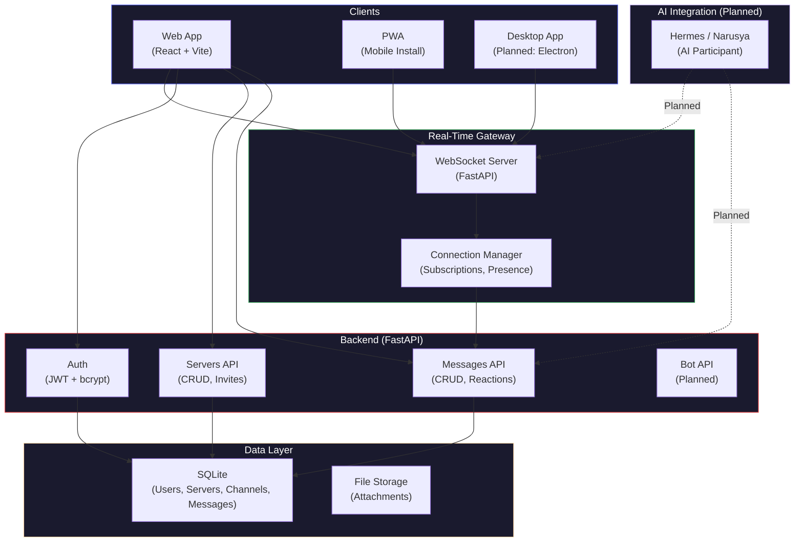
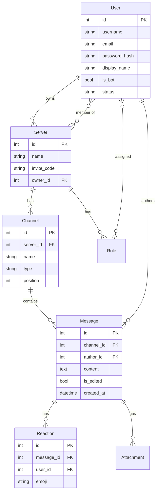

# Quetzalcoatl

Self-hosted, open-source messaging platform. Discord-like features, mesh-networked, AI-native. Hermes as backbone.

Built by **Adora** and **Narusya**. Named after the feathered serpent. 🐍

## Architecture



## Data Model



## Feature Roadmap

```mermaid
graph LR
    subgraph Done["Done"]
        A1[Auth]
        A2[Servers]
        A3[Channels]
        A4[Messages]
        A5[Reactions]
        A6[WebSocket]
        A7[PWA]
        A8[Invites]
    end

    subgraph Tier1["Tier 1: Core (MVP)"]
        B1[Direct Messages]
        B2[File Attachments]
        B3[Hermes AI]
    end

    subgraph Tier2["Tier 2: v1.0"]
        C1[Voice/Video]
        C2[Threads]
        C3[Search]
        C4[Desktop App]
        C5[Bot API]
        C6[Webhooks]
    end

    subgraph Tier3["Tier 3: v2.0"]
        D1[Forums]
        D2[Stage Channels]
        D3[Polls]
        D4[Themes]
        D5[E2E Encryption]
    end

    Done --> Tier1
    Tier1 --> Tier2
    Tier2 --> Tier3

    style Done fill:#b2f2bb,stroke:#2f9e44,color:#000
    style Tier1 fill:#a5d8ff,stroke:#1971c2,color:#000
    style Tier2 fill:#ffd8a8,stroke:#e8590c,color:#000
    style Tier3 fill:#d0bfff,stroke:#7950f2,color:#000
```



## Features

### ✅ Implemented
- **User accounts** — registration, login, JWT authentication, bcrypt password hashing
- **Servers (guilds)** — create, list, join via invite code, owner/member management
- **Channels** — text and voice channel types, per-server channel lists
- **Real-time messaging** — WebSocket gateway with live message delivery, typing indicators, presence
- **Message operations** — send, edit, delete, reply, reactions (emoji)
- **Invite system** — every server gets a unique invite code; share to invite friends
- **Mobile-responsive UI** — works on phones and desktops
- **PWA support** — installable on any device via "Add to Home Screen"; offline caching, push notifications
- **WebSocket gateway** — connection management, channel subscriptions, broadcast

### 🔜 Planned

#### Tier 1: Core (MVP — mostly done)
- [x] User accounts (register, login, profile)
- [x] Servers/guilds (create, join, leave)
- [x] Text channels (create, delete, organize)
- [x] Message sending (text, markdown, replies)
- [x] Message editing/deletion
- [x] Reactions (emoji)
- [x] Roles and permissions (basic)
- [x] Server invites (invite codes)
- [x] Web client (browser-based, mobile-responsive)
- [x] REST API
- [x] WebSocket real-time gateway
- [ ] Direct messages (1:1 and group DMs) — models exist, API routes coming
- [ ] File attachments (images, documents, uploads)
- [ ] Hermes integration (AI participant) — planned as native channel member

#### Tier 2: Important (v1.0)
- [ ] Voice channels (WebRTC audio)
- [ ] Screen sharing
- [ ] Threads (within channels)
- [ ] Pinned messages
- [ ] Message search (across channels/servers)
- [ ] Custom emoji (server-specific)
- [ ] Audit log
- [ ] Notification settings (per-channel, per-server)
- [ ] Desktop app (Electron or Tauri)
- [ ] Bot API (application commands, slash commands)
- [ ] Webhooks (incoming)
- [ ] Typing indicators (backend exists, frontend integration)
- [ ] Read receipts / unread counts
- [ ] Link previews (unfurling)
- [ ] User status (online, idle, DND, invisible)
- [ ] Custom status messages

#### Tier 3: Nice-to-Have (v2.0)
- [ ] Forum channels (threaded discussions with tags)
- [ ] Stage channels (audio events, speaker/audience model)
- [ ] Events (scheduled)
- [ ] Polls
- [ ] Custom themes / CSS
- [ ] Mobile apps (PWA first, native later)
- [ ] Android APK (sideloadable, via Capacitor)
- [ ] E2E encryption
- [ ] Rich Presence (game activity)
- [ ] Channel categories
- [ ] Member screening (rules acceptance)
- [ ] Verification levels
- [ ] Timeout (temporary mute)
- [ ] Ban/kick moderation
- [ ] AutoMod (keyword filters, spam detection)
- [ ] Server templates

#### Tier 4: Skip (not needed for open source)
- [ ] Monetization (Nitro, boosts, shop)
- [ ] Age verification
- [ ] Server discovery
- [ ] Orbs/Quests
- [ ] Profile frames/effects

## Quick Start

### Prerequisites
- Python 3.11+
- Node.js 18+

### Backend

```bash
cd backend
python3 -m venv .venv
source .venv/bin/activate
pip install -r requirements.txt
uvicorn main:app --host 0.0.0.0 --port 8000
```

### Frontend

```bash
cd frontend
npm install
npm run build
# The backend serves the built frontend from frontend/dist/
```

### Development

```bash
# Backend (with auto-reload)
cd backend && .venv/bin/uvicorn main:app --reload --port 8000

# Frontend (with HMR)
cd frontend && npm run dev
```

### Access from phone

Open `http://<your-server-ip>:8000` in your phone browser → "Add to Home Screen" to install as an app.

## Architecture

- **Backend:** Python (FastAPI) + SQLAlchemy + SQLite
- **Real-time:** WebSocket gateway with connection management, channel subscriptions, presence
- **Frontend:** React + Vite (mobile-responsive, PWA-enabled)
- **Auth:** JWT tokens with bcrypt password hashing
- **Voice:** WebRTC (planned)
- **AI:** Hermes integration as native participant (planned)
- **Database:** SQLite (dev), PostgreSQL (planned for production)

## Project Structure

```
quetzalcoatl/
├── backend/
│   ├── main.py              # FastAPI app, router aggregation, startup hooks
│   ├── auth.py              # JWT + password hashing, get_current_user dependency
│   ├── models/
│   │   ├── __init__.py      # DB engine, session, init_db, re-exports all models
│   │   └── database.py      # SQLAlchemy models (User, Server, Channel, Message, etc.)
│   ├── api/
│   │   ├── __init__.py
│   │   ├── auth_routes.py   # Register, login, /me
│   │   ├── servers.py       # Server + channel CRUD, join via invite
│   │   └── messages.py      # Message CRUD, reactions
│   └── gateway/
│       └── websocket.py     # WebSocket gateway, connection manager
├── frontend/
│   ├── src/
│   │   ├── App.jsx          # Main React app (mobile-responsive)
│   │   ├── api.js           # API client
│   │   └── stores/
│   │       └── auth.js      # Auth state (Zustand)
│   ├── public/
│   │   ├── manifest.json    # PWA manifest
│   │   ├── sw.js            # Service worker (offline + push)
│   │   └── icon-*.png       # App icons
│   └── dist/                # Built frontend (served by backend)
├── README.md
└── .gitignore
```

## API Reference

| Endpoint | Method | Description |
|----------|--------|-------------|
| `/api/auth/register` | POST | Register new user |
| `/api/auth/login` | POST | Login (OAuth2 form) |
| `/api/auth/me` | GET | Get current user |
| `/api/servers` | GET | List user's servers |
| `/api/servers` | POST | Create server (auto-creates #general + voice channel) |
| `/api/servers/{id}` | GET | Get server details |
| `/api/servers/{id}/channels` | GET | List channels |
| `/api/servers/{id}/channels` | POST | Create channel |
| `/api/servers/join/{code}` | POST | Join server via invite code |
| `/api/channels/{id}/messages` | GET | List messages (paginated) |
| `/api/channels/{id}/messages` | POST | Send message |
| `/api/messages/{id}` | PATCH | Edit message |
| `/api/messages/{id}` | DELETE | Delete message |
| `/api/messages/{id}/reactions` | POST | Add reaction |
| `/api/messages/{id}/reactions/{emoji}` | DELETE | Remove reaction |
| `/ws?token=...` | WebSocket | Real-time gateway |

## WebSocket Protocol

Connect to `/ws?token=<jwt>` and send JSON messages:

```json
{ "type": "subscribe", "channel_id": 1 }
{ "type": "message", "channel_id": 1, "content": "Hello!" }
{ "type": "typing", "channel_id": 1 }
{ "type": "ping" }
```

Server broadcasts:
```json
{ "type": "message", "id": 1, "channel_id": 1, "author_username": "user", "content": "Hello!", ... }
{ "type": "subscribed", "channel_id": 1 }
{ "type": "typing", "user_id": 1, "channel_id": 1 }
{ "type": "pong" }
```

## License

MIT

## Credits

Built by Adora and Narusya. Named after the feathered serpent. 🐍🜂